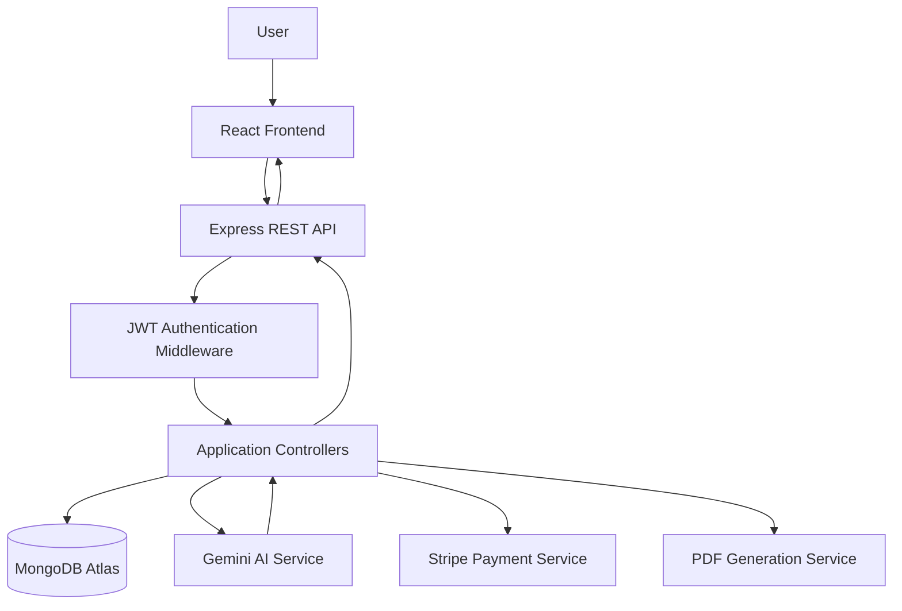
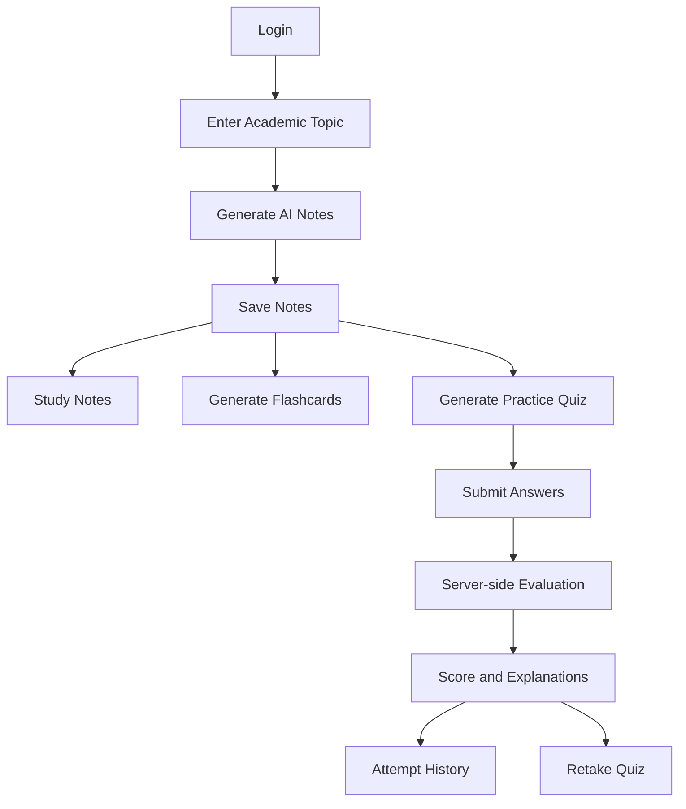

# ExamNotes AI — AI-Powered Learning Platform

An intelligent full-stack learning platform that transforms academic topics into structured study notes, interactive flashcards, practice quizzes, and visual learning resources using Generative AI.

## Live Demo

- **Frontend:** https://exam-notes-ai-dusky.vercel.app
- **Backend:** https://examnotes-aiserver-jfai.onrender.com
- **GitHub:** https://github.com/Chaiti487/ExamNotes-AI

## Key Features

### AI-Powered Notes Generation

- Generate structured, topic-specific academic notes.
- Customize content based on academic level and examination type.
- Identify important subtopics and examination questions.
- Access quick revision points for efficient preparation.

### AI Flashcards

- Automatically generate 10 question-answer flashcards from saved notes.
- Interactive card-flipping animations.
- Navigate between cards and track revision progress.
- Retrieve previously generated flashcards without repeated AI requests.

### AI Practice Quiz

- Generate 10 multiple-choice questions based on study notes.
- Four answer options for each question.
- Interactive question navigation and progress tracking.
- Server-side answer evaluation and score calculation.
- Detailed answer explanations after submission.
- Unlimited practice attempts.

### Performance Tracking

- View quiz scores and percentages.
- Track correct, incorrect, and unanswered questions.
- Access previous quiz attempt history.
- Identify areas requiring further revision.

### Visual Learning

- AI-generated diagrams using Mermaid.js.
- Interactive charts using Recharts.
- Visual representation of relevant academic concepts.

### Personal Study Library

- Save and retrieve previously generated notes.
- Access associated flashcards and quizzes.
- Maintain a personalized learning history.

### Authentication and Payments

- JWT-based authentication.
- Google authentication using Firebase.
- Protected API routes and user-specific resources.
- Credit-based notes generation.
- Stripe payment integration for purchasing credits.

### PDF Export

- Download generated notes as PDF documents.
- Access study materials offline.

## Technology Stack

| Category | Technologies |
|---|---|
| Frontend | React.js, Tailwind CSS, Redux Toolkit |
| Backend | Node.js, Express.js |
| Database | MongoDB, Mongoose |
| Generative AI | Google Gemini API |
| Authentication | JWT, Firebase Authentication |
| Payments | Stripe |
| Animations | Framer Motion |
| Visualization | Mermaid.js, Recharts |
| PDF Generation | PDFKit |
| API Communication | Axios |
| Deployment | Vercel, Render, MongoDB Atlas |
| Version Control | Git, GitHub |

## System Architecture



## Learning Workflow



## Project Structure

```text
ExamNotes-AI/
├── client/
│   ├── src/
│   │   ├── assets/
│   │   ├── components/
│   │   │   ├── Flashcards.jsx
│   │   │   ├── Quiz.jsx
│   │   │   ├── FinalResult.jsx
│   │   │   ├── TopicForm.jsx
│   │   │   ├── MermaidSetup.jsx
│   │   │   └── Rechartsetup.jsx
│   │   ├── pages/
│   │   ├── redux/
│   │   ├── services/
│   │   └── utils/
│   └── package.json
├── server/
│   ├── controllers/
│   ├── middleware/
│   ├── models/
│   ├── routes/
│   ├── services/
│   ├── index.js
│   └── package.json
├── .gitignore
└── README.md
```

## API Endpoints

### Notes

| Method | Endpoint | Description |
|---|---|---|
| POST | `/api/notes/generate-notes` | Generate academic notes |
| GET | `/api/notes/getnotes` | Retrieve saved notes |
| GET | `/api/notes/:id` | Retrieve a specific note |

### Flashcards

| Method | Endpoint | Description |
|---|---|---|
| POST | `/api/flashcards/generate/:noteId` | Generate or retrieve cached flashcards |
| GET | `/api/flashcards/:noteId` | Retrieve saved flashcards |

### Quiz

| Method | Endpoint | Description |
|---|---|---|
| POST | `/api/quiz/generate/:noteId` | Generate or retrieve a cached quiz |
| GET | `/api/quiz/:noteId` | Retrieve quiz questions |
| POST | `/api/quiz/submit/:quizId` | Submit answers and calculate results |
| GET | `/api/quiz/attempts/:quizId` | Retrieve quiz attempt history |

## Engineering Highlights

- **AI Response Validation:** Validates generated flashcards and quiz structures before database storage.
- **Caching:** Reuses previously generated study resources to reduce redundant AI API requests.
- **Database Indexing:** Compound unique indexes are defined to prevent duplicate study resource records.
- **Server-side Evaluation:** Quiz scores are calculated on the backend.
- **Answer Protection:** Correct answers and explanations are excluded from initial quiz responses.
- **Resource Ownership:** Ownership checks are implemented for flashcards and quiz resources.
- **Input Validation:** Rejects malformed identifiers and invalid quiz submissions.
- **Authentication:** Missing, invalid, and expired authentication tokens are handled by JWT middleware.
- **Environment Security:** Local environment files are excluded from Git tracking.

## Local Installation

### Prerequisites

- Node.js and npm
- MongoDB database
- Google Gemini API key
- Firebase project
- Stripe account

### Clone the Repository

```bash
git clone https://github.com/Chaiti487/ExamNotes-AI.git
cd ExamNotes-AI
```

### Backend Setup

```bash
cd server
npm install
```

Create a `.env` file inside the server directory and configure the required MongoDB, JWT, Gemini, Stripe, and application environment variables according to the backend configuration.

```bash
npm run dev
```

The backend runs locally at `http://localhost:8000`.

### Frontend Setup

Open another terminal from the project root:

```bash
cd client
npm install
```

Create a `.env` file inside the client directory:

```env
VITE_API_URL=http://localhost:8000
```

Configure any additional Firebase environment variables required by the application.

```bash
npm run dev
```

Open `http://localhost:5173` in your browser.

## Testing and Validation

| Test | Result |
|---|---|
| Frontend production build | Passed |
| Unauthenticated API request rejection | Passed |
| Invalid MongoDB identifier validation | Passed |
| Invalid quiz answer validation | Passed |
| Zero-score calculation | Passed |
| Full-score calculation | Passed |
| Quiz answer protection before submission | Verified |
| Cached study resource generation | Verified |

## Future Enhancements

- Adaptive quiz difficulty.
- Spaced repetition for flashcards.
- Personalized study recommendations.
- Advanced learning analytics.
- Timed practice examinations.
- Frontend bundle optimization.
- Automated integration and security tests.

## Author

**Chaiti Sen**

Information Technology — Jalpaiguri Government Engineering College

GitHub: https://github.com/Chaiti487

---

Built to make academic preparation more interactive, accessible, and efficient through artificial intelligence.